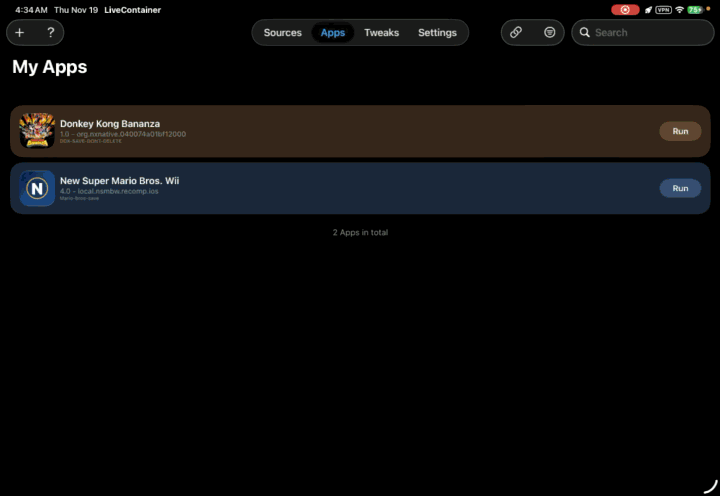

# New Super Mario Bros. Wii — native macOS, Windows, iPad & Switch build kit

Turn **your own copy** of New Super Mario Bros. Wii into a native app: a `.app` on Apple silicon, a
`.exe` folder on Windows, an unsigned IPA for an iPhone or iPad, or a standalone NSP for a modded
Nintendo Switch. No emulator, no JIT — the game's
PowerPC code is translated ahead of time to C++ and compiled for your machine, with the Wii's
graphics rebuilt on Metal or D3D12.

This is a build kit, not a game. It contains no game code, no assets, no keys and no disc images.

| Platform | Status |
|---|---|
| **macOS** | ✅ tested — Apple silicon, ~58 fps, Metal |
| **Windows** | ✅ tested — Windows 11 x64, ~58 fps, D3D12 |
| **iPad / iPhone** | ✅ tested — iPad Pro M4, iPadOS 26, unsigned IPA via LiveContainer |
| **Nintendo Switch Lite** | v1.1 native build at 1×. The hardware capture averaged 55.9 FPS in one course and 38.2 FPS in the water level, with sustained stretches near 30 FPS. [Build guide and results](docs/REBUILD.md#v11-switch-lite-release) |
| **Game version** | USA, `SMNE01`, revision 1 |
| **LAN play** | ⚠️ beta (desktop only) |
| **Known issue** | ⚠️ world-map crash after a course — [details](docs/known-issues.md) |
| **iOS gyro** | ⚠️ controller motion does not reach the app; L1/R1 tilt instead — [details](docs/ios.md#known-gaps) |

<p align="center"></p>

<sub>If this saves you time, a star helps other people find it — for a project like this, that is most of how it gets discovered.</sub>

## What you need

- **Your own disc dump** of New Super Mario Bros. Wii (USA, `SMNE01`, rev 1) as `.rvz`, `.iso`,
  `.wbfs`, `.gcz` or `.wia`. Nothing here helps you obtain it.
- **macOS**: Apple silicon, macOS 14+, Xcode Command Line Tools, Homebrew, and the Metal toolchain
  (`xcodebuild -downloadComponent MetalToolchain`). The script installs nothing else by itself.
- **Windows**: Windows 10/11 x64, [.NET 8 SDK](https://dot.net), Python 3 x64, git. The pinned
  compiler toolchain is downloaded by the build.
- **iPad / iPhone**: iPadOS or iOS 16+, a Mac with Xcode and an iOS SDK, and
  [LiveContainer](https://github.com/LiveContainer/LiveContainer) (or SideStore) to install the IPA.
- **Disk**: about 6 GB of free space per build (the finished app is ~460 MB; the IPA ~360 MB).

## Build it

### macOS

```bash
./make-nsmbw.sh --disc "/path/to/New Super Mario Bros. Wii (USA) (Rev 1).rvz"
```

You get `~/wii-port/nsmbw-build/New Super Mario Bros. Wii.app` (self-contained: the game data is
inside the bundle) plus a Finder alias on your Desktop. Open it like any app.

### Windows

```powershell
.\make-nsmbw.ps1 -Disc "D:\dumps\New Super Mario Bros. Wii (USA) (Rev 1).rvz"
```

You get `...\nsmbw-build\dist\NSMBW-Windows\New Super Mario Bros. Wii.exe` next to its `game`
folder and DLLs, plus a shortcut on your Desktop.

Both desktop scripts are **resumable**: rerunning skips the translation, CMake configure and
unchanged compiles, so a second build takes minutes instead of ~20–30.

### iPad / iPhone

```bash
./make-nsmbw-ios.sh --disc "/path/to/New Super Mario Bros. Wii (USA) (Rev 1).rvz" --version 1
```

You get `~/wii-port/nsmbw-ios-build/New Super Mario Bros. Wii v1.ipa` — unsigned, for LiveContainer
or SideStore. It runs the same translation stage the desktop scripts use, then configures the same
sources for arm64 iOS, builds, and packs the IPA with its game data and icon.

Needs Xcode with an iOS SDK, CMake and Ninja. Reruns are resumable; `--no-translate` reuses sources
that are already translated, and `--configure-only` stops after CMake when something looks wrong.

The details — what the iOS patch changes and why, the pinned Dawn archive, installing, on-device
paths and the two open gaps — are in **[docs/ios.md](docs/ios.md)**.

### Nintendo Switch

On macOS or Linux, run:

```bash
./make-nsmbw-switch.sh --disc "/path/to/New Super Mario Bros. Wii (USA) (Rev 1).rvz"
```

On Windows, open PowerShell with Docker Desktop running in Linux containers mode:

```powershell
.\make-nsmbw-switch.ps1 -Disc 'D:\Wii dumps\New Super Mario Bros. Wii (USA) (Rev 1).rvz'
```

You get `build/switch/aaa-nsmbw-v1.1.3-standalone.nsp`. It includes the disc data and runs from
the installed title. The game creates its saves and shader cache on the SD card on first launch.
Leave the game open while it compiles its shaders on that first launch.

macOS and Linux also need the .NET 8 SDK, Python 3.10+, Git and curl. The Windows builder includes
these tools in its Docker image. Both commands read your local Switch key file from
`~/.switch/prod.keys` by default. Pass `--keys PATH` on macOS or Linux, or `-Keys PATH` on Windows,
if it lives elsewhere.

Allow about 10 GB free for the first build. Reruns reuse the translated code and compiled objects.
Use `--disc-dir` or `-DiscDir` for an extracted disc and `--icon` or `-Icon` for a custom HOME icon.
See the [Switch rebuild guide](docs/REBUILD.md#standalone-nsp-builder) for details.

### Useful options

| macOS | Windows | Meaning |
|---|---|---|
| `--disc-dir DIR` | `-DiscDir DIR` | reuse an already extracted disc (`sys/` + `files/`) |
| `--out DIR` | `-Out DIR` | work and output folder |
| `--repo DIR` | `-Repo DIR` | reuse an existing checkout of the source |
| `--icon PNG` | — | app icon (macOS) |
| `--no-app` | — | stop at the binary |
| `--clean` | `-Clean` | wipe the work folder first |

## Playing

- **F10** opens settings: resolution (up to 8×), aspect (4:3 / **16:10** / 16:9 / fill), display mode
  (windowed / borderless / exclusive), audio, controls, and **button labels**.
- **Button labels** can be forced to PlayStation, Xbox or Nintendo naming, and the choice is saved as
  `[controller] button_layout` (`0` auto, `1` PlayStation, `2` Xbox, `3` Nintendo). The iOS build
  defaults to Xbox names.
- **Controllers**: connect a pad and it is picked up automatically and mapped by position (Switch
  layout: right A, bottom B, top X, left Y). Mappings persist per device. Four pads work.
- **On iPad the remote's tilt is on L1/R1** (hold to roll left/right): the controller's own gyro is
  not delivered to apps on current iPadOS. See [docs/ios.md](docs/ios.md#known-gaps).
- **LAN play is beta** and desktop only. Rooms are found on your Wi-Fi automatically; Tailscale works
  for remote players and needs no port forwarding. A session shows `N ms  delay N` at the top of the
  screen: the round trip and the input delay in force. If a remote session hitches and then skips
  ahead, raise **F10 › LAN › Input delay**; if everything feels late, lower it.
- Saves: `~/Library/Application Support/WiiCompiled/NAND` (macOS),
  `%USERPROFILE%\Documents\MarioWiiSaveData\NAND` (Windows), and on iOS
  `Documents/WiiCompiled/NAND` inside the app's container.

## What the scripts fix

The desktop port needs five changes on top of the upstream sources. `apply-patches.py` applies them
idempotently and reports each one, so reruns are safe:

1. **Boot hang at the disc's BCA check.** `DVDCheckDiskBca` waits for a DI interrupt no host raises,
   so the game spins forever after its engine initialises. Answered natively, the way an emulator
   without a `.bca` file does.
2. **macOS netplay restart.** Upstream has Windows/Android/Linux restart branches only; on a Mac every
   LAN session died at `restarting into session`.
3. **Button-label families** (PlayStation / Xbox / Nintendo) with the F10 picker.
4. **LAN labelled beta** wherever the player meets it.
5. **Online input buffer sized from the link.** The lockstep buffer was half the ping plus a guessed
   12 ms, rounded down and capped at 8 frames, which stalls on any real connection and then skips
   frames to catch up. It now covers the measured ping and jitter, the player count, and can be set
   by hand in F10 › LAN (`[netplay] input_delay`).

The iOS build adds `patches/ios-port.patch` on top: an iOS platform branch, a launch-time guest
memory base, a temp-file backing for guest RAM, the `UIApplicationMain` entry through SDL, in-bundle
game data, static dependencies and the shoulder-tilt fallback. Each is explained in
[docs/ios.md](docs/ios.md).

If your dump's `main.dol` differs from the table's, the scripts record its checksum instead of
refusing it — disc ID, revision, FST size, entry point and the REL prelink still validate the dump.
A mismatch usually means a patched executable, and it is the first thing to suspect if a build
misbehaves.

## How it works, and what goes wrong

- [docs/how-it-works.md](docs/how-it-works.md) — the pipeline stage by stage.
- [docs/troubleshooting.md](docs/troubleshooting.md) — every failure met while building this, with
  the fix.
- [docs/ios.md](docs/ios.md) — the iOS port: what it took, how to build and install it, what is
  missing.
- [docs/known-issues.md](docs/known-issues.md) — open bugs, including the world-map crash.
- [docs/faq.md](docs/faq.md) — direct answers: native Mac/PC/iPad without an emulator, the game
  version, online play, saves, what is broken.
- [llms.txt](llms.txt) — the same facts in the form crawlers and assistants read.

## Legal

Bring your own game. This repository ships scripts and patch code only: no game code, assets, keys
or discs. Dumping a disc you own and running it is your responsibility under your local law, and this
project is not affiliated with Nintendo, the upstream recompilation authors, or anyone else.
The scripts are GPL-3.0 because they patch and build a GPL-3.0 program.

## Credits

- [WitherBlitz/NSMB-Wii-Multiplayer-Recompilation](https://github.com/WitherBlitz/NSMB-Wii-Multiplayer-Recompilation)
  and the [WiiCompiled](https://github.com/patchzyy/Wiicompiled) project it is built on — the translator,
  runtime and everything that actually runs the game.
- [encounter/nod](https://github.com/encounter/nod) — `nodtool`, used to extract the disc.
- [aurora](https://github.com/encounter/aurora) and [Dawn](https://dawn.googlesource.com/dawn) — the
  graphics layer behind Metal/D3D12, and the prebuilt Dawn for iOS arm64 used by the iPad build.
- [SDL3](https://github.com/libsdl-org/SDL) — window, audio, controllers and the iOS app lifecycle.
- [LiveContainer](https://github.com/LiveContainer/LiveContainer) — how the IPA is installed without
  a developer account.
